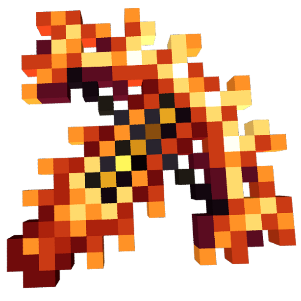

# 🔮 Ender Vantasy — Custom Texturepack

  

  <b>Inspired by BPK SMP</b> 
  <i>Resource pack fokus Combat, Senjata, Zirah, Totem, dan Custom Item Textures (CIT) untuk Minecraft Java Edition.</i>

---

## 📖 Tentang Pack Ini
**Ender Vantasy** adalah texture pack yang dirancang khusus untuk pengalaman pertarungan (PvP/PvE) dan petualangan RPG yang bersih, elegan, dan berkinerja tinggi. Seluruh tekstur blok bangunan, suara, dan mob lingkungan tetap dibiarkan **100% vanilla**, sehingga tidak mengorbankan FPS serta tetap menjaga keaslian dunia Minecraft Anda.

---

## 📦 Daftar Isi & Fitur Lengkap

### 1. ⚔️ Senjata & Alat Tempur
- **Pedang & Senjata Utama**: Tampilan ikon kustom pedang (Netherite, Diamond, Iron, dll.).
- **Busur & Crossbow**: Dilengkapi animasi tarikan tali bertahap (*pulling animation*) yang presisi.
- **Trisula (Trident)**: Tampilan 3D di tangan serta tekstur saat dilempar dan animasi *Riptide*.
- **Perisai (Shield)**: Model perisai bersih dengan dukungan variasi motif bendera/banner.
- **Anak Panah**: Tampilan proyektil anak panah (*Arrow*, *Spectral Arrow*, dan *Tipped Arrows*).

### 2. 🛡️ Zirah (Armor) & Trims
- **Armor Set Lengkap**: Tampilan ikon di inventaris serta model saat terpasang pada badan pemain/armor stand (Netherite, Diamond, Iron, Gold, Chainmail, Leather).
- **Format Modern 1.21+**: Mendukung sistem *equipment layer* terbaru Minecraft 1.21.2+.
- **Armor Trims**: Kompatibel dengan semua pola hiasan *Smithing Template* (Vex, Ward, Silence, Tide, dll.).

### 3. 🧿 Totem of Undying & Utilitas
- **Totem of Undying**: Desain ikon totem khusus serta animasi partikel saat efek penyelamat nyawa aktif.
- **Potion & Ramuan**: Botol ramuan (*regular, splash, lingering*) dengan pewarnaan yang mudah dibedakan saat combat.

### 4. ⚡ Efek Visual Pertarungan (Combat FX)
- **Partikel Kritis (*Critical Hit*)**: Partikel serangan tajam saat melancarkan *critical strike*.
- **Sabetan Pedang (*Sword Sweep*)**: Animasi tebasan pedang horizontal yang dinamis.
- **Kilau Sihir (*Enchanted Glint*)**: Efek kilau magis ungu yang lebih halus dan tidak menutupi detail senjata.
- **Efek Menyala (*Emissive Textures*)**: Didukung oleh file `emissive.properties` agar detail senjata dan armor tertentu dapat memancarkan cahaya neon jika menggunakan OptiFine / Iris Shaders.

### 5. ✨ Custom Item Textures (CIT)
- Mengubah bentuk senjata dan item menjadi perlengkapan bertema RPG saat di-*rename* menggunakan Anvil.
- Koleksi buku sihir unik berdasarkan tipe enchantment (*Enchanted Books*).
- Mahkota (*Crowns*) dan Diadem khusus saat helm tertentu di-*rename*.
- Ember khusus untuk Axolotl dan Ikan Tropis.

---

## 🐢 Hal yang Sengaja Dibiarkan Asli (Vanilla Defaults)
Untuk menjaga keadilan gameplay, keaslian visual, dan fleksibilitas:
- **Sayap Elytra**: 100% menggunakan tampilan sayap dan ikon vanilla bawaan game.
- **Turtle Shell (Helm Kura-kura)**: Dinonaktifkan dari sistem CIT/mahkota agar wujud helm kura-kura tidak tertutup dan selalu tampak sebagai Turtle Shell asli.
- **Blok Bangunan & Lingkungan**: Semua blok batu, tanah, kayu, daun, dan langit tetap vanilla (bebas lag).
- **Menu Utama**: Logo layar pembuka tetap menampilkan tulisan batu **"MINECRAFT"** standar.

---

## 🗡️ Galeri & Daftar Bentuk Senjata
Semua senjata, zirah, dan item kustom di pack ini dapat diakses dengan cara me-rename item pada **Anvil**.

📖 **[👉 Buka Katalog Lengkap 3.000+ Nama Anvil & Display di Sini (ANVIL_NAMES.md)](ANVIL_NAMES.md)**

### Ringkasan Kategori Senjata & Item:
- ⚔️ **Pedang & Senjata Melee** (385 variasi: Katanas, Scythes, Daggers, Greatswords, Glaives, Rapiers)
- 🪓 **Kapak & Battleaxes** (237 variasi kapak perang & battleaxe)
- 🏹 **Busur, Crossbow & Tongkat Sihir** (296 variasi busur dan staves)
- 🛡️ **Perisai (Shields & Bucklers)** (137 variasi perisai)
- 🔱 **Trisula & Tombak (Spears)** (166 variasi spears & tridents)
- 🧿 **Totem of Undying** (39 variasi totem kustom)
- 👑 **Zirah, Helm & Mahkota (Armor & Crowns)** (1.177 variasi armor sets, crowns & diadems)
- ⛏️ **Beliung & Perkakas** (338 variasi pickaxe, sekop, cangkul)
- 🧪 **Ramuan & Potions** (242 variasi botol sihir)

> *Cukup letakkan item yang sesuai pada Anvil dan beri nama persis seperti yang ada di daftar untuk mengubah tampilannya secara instan!*

---

## 🎮 Kompatibilitas Versi
- **Minecraft Java Edition**: Versi **1.20 hingga 1.21.x** (mendukung format *pack format 16* hingga *76* dengan overlay komponen versi otomatis).
- **Mod Rekomendasi**:
  - **OptiFine** ATAU
  - **Fabric / Iris Shaders** + mod [CIT Resewn](https://modrinth.com/mod/cit-resewn) / [Entity Model Features](https://modrinth.com/mod/entity-model-features) untuk mengaktifkan seluruh fitur CIT dan emissive glow.

---

## 📥 Panduan Pemasangan
1. Unduh file `Ender Vantasy.zip` dari halaman [Releases](https://github.com/NDERXZ/Ender-Vantasy-Custom-Texturepack/releases).
2. Buka Minecraft Anda > Masuk ke **Options...** > **Resource Packs...**.
3. Klik tombol **Open Pack Folder**.
4. Masukkan file `Ender Vantasy.zip` ke dalam folder tersebut.
5. Pindahkan pack ke kolom kanan (*Selected*), lalu klik **Done**!
